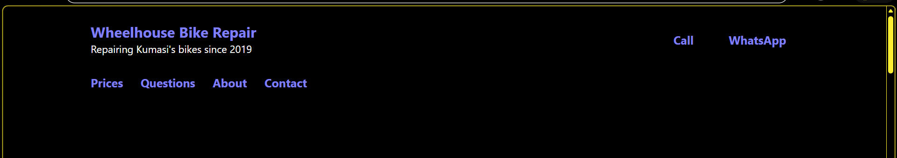
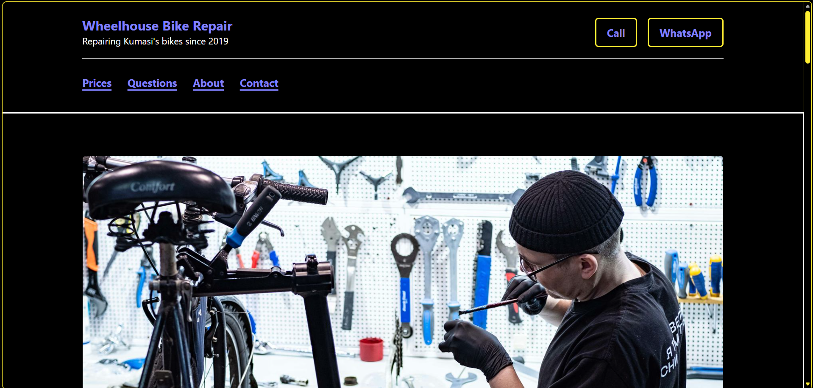
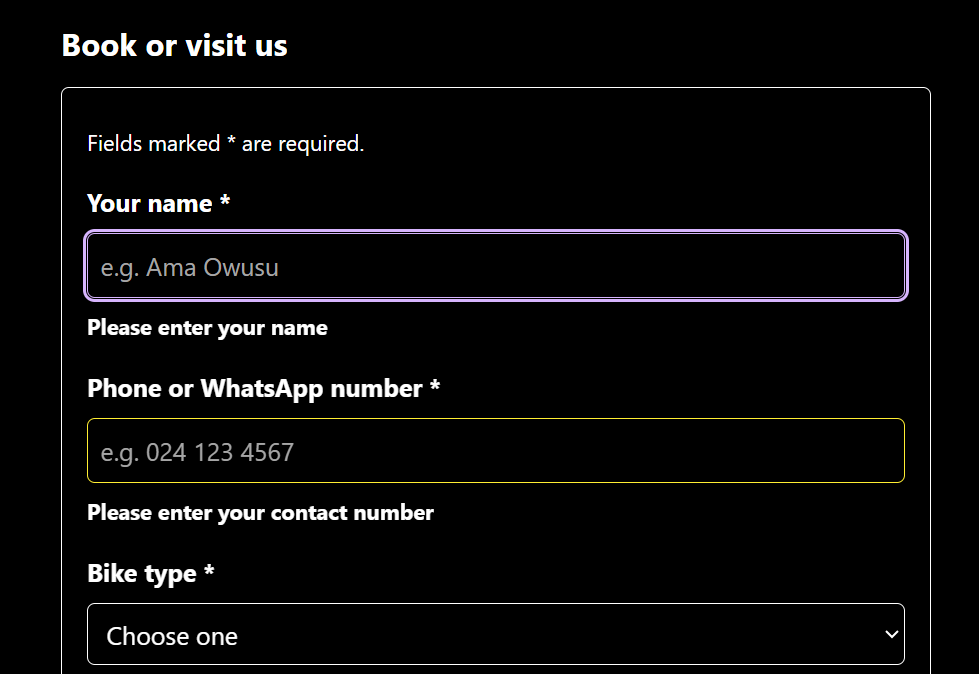
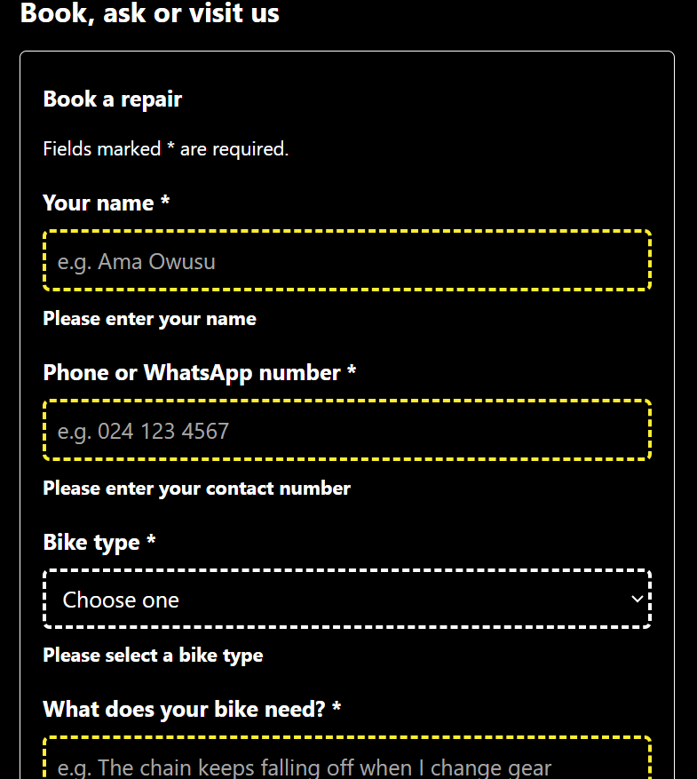

# Accessibility fixes: what changed and why

My pair, Zakari, audited my site and found **3 fails and 3 warnings**. This page goes through each one: what he found, why it matters, and what I did about it. At the end is one extra improvement his audit didn't cover.

The customer in the brief had **one arm in a cast**. He tried to book on his phone using one hand, then on his laptop using only the keyboard. I kept him in mind for every decision.

## Summary

| # | Zakari's finding | Level | What I did |
|---|---|---|---|
| 1 | Focus ring is almost invisible on the header buttons | Fail | **Fixed** |
| 2 | Call and WhatsApp come before the menu in the tab order | Fail | **Not changed** (explained below) |
| 3 | "Ask on WhatsApp", "Call" and "WhatsApp" links repeat the same words | Fail | **Already in place / not changed** (explained below) |
| 4 | The booking button opens WhatsApp without warning | Warning | **Fixed** |
| 5 | The form only uses the browser's pop-up error messages | Warning | **Fixed** |
| 6 | Small tap areas on the menu links and email link | Warning | **Not changed** (explained below) |
| + | Extra: the site breaks in Windows contrast themes | – | **Added** |

---

## 1. Focus ring almost invisible in the header (Fixed)

**What Zakari found.** When you press Tab to reach Call or WhatsApp in the header, the focus ring is dark (`#1a1a1a`) on the dark navy header (`#2c3e50`). That is only **1.58 : 1**, so the ring seems to disappear.

**Why it matters.** The focus ring is the keyboard user's mouse pointer. It shows them where they are on the page. If it disappears, they are lost. This breaks **2.4.7 Focus Visible** and **1.4.11 Non-text Contrast** (a focus ring needs at least 3 : 1).
- **Principle:** Operable and Perceivable.
- **Who it protects:** keyboard-only users, like the customer with the cast on his laptop, and people with low vision.

**What I changed.** In `styles.css`, everything inside the header now gets a light focus ring:

```css
.site-header :focus-visible {
  outline-color: var(--color-surface);   /* #f4f4f4 */
}
```

Light grey on navy is about **10 : 1**, far above the 3 : 1 needed. The rest of the page keeps its dark ring, because there the background is light.

**Why it works everywhere.** The global focus rule uses `currentColor`, the colour of the text. Inside the header I only change the colour, so the thickness (3px) and gap (2px) stay the same as everywhere else.

---

## 2. Tab order: Call and WhatsApp before the menu (Not changed)

**What Zakari found.** Pressing Tab goes: logo → Call → WhatsApp → Prices → Questions → About → Contact. He suggested moving the menu before the buttons.

**Why I didn't change it.** The rule (**2.4.3 Focus Order**) says the tab order must follow a **logical order that matches what you see**. On my page, the menu sits on its own row **below** the Call and WhatsApp buttons. So top to bottom, the visual order is already: logo, Call, WhatsApp, then the menu. The tab order matches it.

If I moved the menu first in the code, focus would jump **down** to the menu and then back **up** to the buttons. That would break the rule instead of fixing it.

**The real problem was Fix 1.** Zakari wrote that focus seemed to "disappear for two presses" on Call and WhatsApp. That was the invisible focus ring, not the order. With the ring fixed, the user can see focus on every step.

Call being reachable in two presses is also good for the customer in the brief. It is the fastest way to reach Kwame.

---

## 3. Repeated link words (Already in place / not changed)

**What Zakari found.** The six service cards all say "Ask on WhatsApp", and "Call" and "WhatsApp" appear twice (header and Visit the workshop card).

**Why it matters.** Screen reader users often pull up a list of all the links on a page. If six links all say "Ask on WhatsApp", they can't tell them apart. This is **2.4.4 Link Purpose**.
- **Principle:** Operable.
- **Who it protects:** screen reader users and voice control users.

**What is already there.** Each service link already has its own label, exactly what Zakari suggested:

```html
<a class="button" href="https://wa.me/..." aria-label="Ask on WhatsApp about Brake Overhaul">Ask on WhatsApp</a>
```

So a screen reader says "Ask on WhatsApp about Brake Overhaul", and a voice control user can still say "click Ask on WhatsApp", because the label **starts with the visible words**.

**Why "Call" and "WhatsApp" stay the same.** Both "Call" links dial the same number, and both "WhatsApp" links open the same chat. They do the same thing, so they should have the same name. That is another rule, **3.2.4 Consistent Identification**: the same action should have the same name everywhere. Giving them different names would make people think they do different things.

---

## 4. Booking button opens WhatsApp without warning (Fixed)

**What Zakari found.** The button said "Send booking request", but it opened WhatsApp instead of sending anything on the page. Someone on a laptop without WhatsApp could fill in the whole form and then get stuck.

**Why it matters.** People need to know what a button will do **before** they press it. This is **3.3.2 Labels or Instructions** and **3.2.5 Change on Request**.
- **Principle:** Understandable.
- **Who it protects:** screen reader users, people with cognitive disabilities, and anyone without WhatsApp. That last group includes the customer in the brief, who was using his laptop.

**What I changed.**
1. The button now says what it does: **"Send booking request via WhatsApp"**.
2. A short note sits just above it: *"This opens WhatsApp with your details filled in. Press send in WhatsApp to finish. No WhatsApp? Call us on 032 200 0000."*
3. The note is connected to the button with `aria-describedby`, so a screen reader reads it out when the button gets focus.

**Why I kept WhatsApp.** The site is hosted on GitHub Pages, which can't receive a form on its own. Kwame already works through WhatsApp. So instead of hiding where the request goes, the page now says it clearly and gives a phone number for anyone without WhatsApp.

---

## 5. Form only used pop-up error messages (Fixed)

**What Zakari found.** If you sent the form with empty fields, the browser showed a small "Please fill out this field" pop-up. It shows one field at a time, and it disappears as soon as you move.

**Why it matters.** Errors must be shown clearly, in words, and say how to fix them. This is **3.3.1 Error Identification** and **3.3.3 Error Suggestion**.
- **Principle:** Understandable.
- **Who it protects:** screen reader users, people with cognitive disabilities, and one-handed users. The customer in the brief types slowly with one hand, and a pop-up that vanishes before he has read it doesn't help him.

**What I changed.**
1. `novalidate` on the form turns off the browser's pop-ups, so my own messages are used instead.
2. Every field has a message space under it. If the field is empty, a clear message appears there in red, for example *"Please enter your contact number"*. **All** the problems show at once, not one at a time.
3. The message is connected to its field with `aria-describedby`, and the field gets `aria-invalid="true"`. A screen reader then reads: the label, "invalid", and the message.
4. The cursor moves to the **first** field with a problem, so the user is taken straight to what needs fixing.
5. When the user fixes a field and sends the form again, that field's message disappears.

**Why I didn't use `aria-live` (Zakari's suggestion).** Moving focus to the first wrong field already makes the screen reader read that field's message. A live region would also read out every message at once, so the user would hear everything twice.

**Colour.** The error red (`#c62828`) is **5.1 : 1** on the grey form card, above the 4.5 : 1 needed for text. The message is also written in words, so colour is never the only sign of a problem.

---

## 6. Small tap areas on menu links and email link (Not changed)

**What Zakari found.** The four menu links and the email link have small tap heights for one-handed phone use.

**Why I didn't change it.** The rule he cited, **2.5.8 Target Size (Minimum)**, asks for at least **24 × 24 pixels**.
- **Menu links:** each one has padding above and below, so it is about **40px tall**. That is well above 24px. (44px is the stricter AAA rule, 2.5.5.)
- **Email link:** it sits inside the address text. 2.5.8 has an exception for links inside a line of text, because making them bigger would break the sentence.

So both already pass.

---

## A note on the colours in the audit

Zakari's "What Passed" table lists `#212529`, `#f8f9fa` and `#6c757d`. These colours are not in my stylesheet. My text colours are `#1a1a1a` and `#4a4a4a`, and my backgrounds are `#ffffff` and `#f4f4f4`. They all pass: the lowest text pair is 8.1 : 1, so the result is the same.

---

## Extra improvement: Windows contrast themes

### Who the audit didn't consider

Some people turn on **Windows Contrast Themes** (Settings → Accessibility → Contrast themes). Windows then replaces every colour on a website with a few strong colours they chose, often white text on black. People who use it include:
- people with **low vision**, who need very strong contrast;
- people with **light sensitivity or migraines**, who need a dark screen;
- some people with **dyslexia**, who read better with certain colours.

Zakari's audit only checked my normal colours, so it didn't cover these users.

### What was broken

In a contrast theme, **background colours are removed**. My site used background colour alone to show a lot of things:
- **Buttons** are yellow boxes. Without the yellow, they looked like plain text, so people couldn't tell they were buttons.
- **Cards** (services, reviews, forms) are grey boxes. Without the grey, they merged into one block.
- **The header and footer** are navy. Without the navy, you couldn't see where they started or ended.
- **Error fields** have a red border. Without the red, a wrong field looked like every other field.

### What I added

Borders **do** stay visible in contrast themes; Windows just gives them its own colour. So at the end of `styles.css` I added a block that only switches on in contrast mode:

```css
@media (forced-colors: active) {
  .button, button.button { border: 2px solid ButtonText; }     /* buttons get an edge */
  .site-header { border-bottom: 2px solid CanvasText; }         /* header end */
  .site-footer { border-top: 2px solid CanvasText; }            /* footer start */
  .service-card, .review-card, #booking-form /* ...all cards */ {
    border: 1px solid CanvasText;                               /* card edges */
  }
  [aria-invalid="true"] { border-width: 3px; border-style: dashed; }  /* error = dashed */
}
```

- `ButtonText` and `CanvasText` are **system colours**: they use the user's chosen theme colours, so they always show up.
- Error fields now get a **thick dashed** border. That is a change of **shape**, not colour, so it works when colours are gone.
- **The normal site looks exactly the same.** This code only runs when a contrast theme is on.

### The principle

- **1.4.11 Non-text Contrast** (Perceivable): buttons, form fields and their states must be visible. In contrast mode, they now are.
- **1.4.1 Use of Color** (Perceivable): colour should not be the only way to show something. The dashed border shows an error without relying on red.

### Before and after

Both screenshots of each pair were taken with the same Windows Contrast theme.

**Header.** Before: Call and WhatsApp look like plain text, and nothing shows where the header ends.



After: Call and WhatsApp have a box, so they look like buttons, and a line marks the end of the header.



**Form sent empty.** Before: the red error border is gone, so the wrong fields look like normal fields. Only the words show the problem.



After: every wrong field has a thick dashed border, so the problem shows by shape as well as by the words.



**To try it:** turn on a contrast theme in Windows. Or in Chrome, open DevTools → More tools → Rendering → "Emulate CSS media feature forced-colors" → active.

---

## How I tested the fixes

I tested with the keyboard and a screen reader, not just a scanner, because the brief says scanners miss the problems that matter most.

| Test | What I checked | Result |
|---|---|---|
| Keyboard only (Tab, Shift+Tab, Enter) | Focus ring visible on every header item; tab order goes top to bottom | ✅ Pass. The ring is clearly visible on Call, WhatsApp and the menu links; the order is logo → Call → WhatsApp → menu. |
| Keyboard, empty form | All messages appear, cursor goes to the first problem field | ✅ Pass. All four messages appeared at once and the cursor moved to "Your name". |
| Narrator (Windows screen reader) | Reads label + "invalid" + message on the wrong field; reads the WhatsApp note on the button | ✅ Pass. On "Your name" it read the label, "invalid" and "Please enter your name". On the submit button it also read the note that the form opens WhatsApp. |
| Phone layout | Everything fits and can be reached at phone width | ⚠️ Checked only in Chrome's phone view (DevTools device mode), not on a real phone. One-thumb tapping on a real device is still untested. |
| Windows Contrast theme | Buttons, cards, header, footer and error fields all have visible edges | ✅ Pass, tested with a real Windows Contrast theme. Buttons and cards have edges and error fields show the dashed border. |
